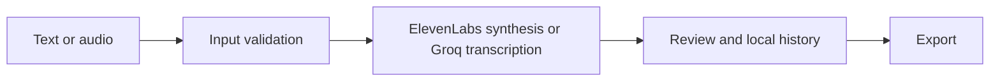

# Sonora — Voice Intelligence

A two-in-one voice workspace for speech synthesis and batch transcription.

**Next.js, React, TypeScript, Tailwind CSS, ElevenLabs, Groq / Whisper Large V3**

## What it does

- Sonora Voice converts text to speech with voice selection, settings, playback and downloads.
- Sonora Scribe validates audio inputs, transcribes files in batches, supports review and exports transcripts.
- Browser-local history and configurable provider keys; server-side defaults and visitor quotas are optional.

## Workflow



## Local setup and use

```powershell
npm install
npm run dev
```
Use a maintained Node.js LTS release. `npm run build` produces the local production build; it does not publish it.
Copy `.env.example` to `.env.local` only if using server defaults. The optional Python helper requires `groq` and `requests`, and reads `GROQ_API_KEY` or `GROQ_API_KEYS` from the environment.

## Configuration

Environment names declared by the included examples (values must be supplied locally):

`ELEVENLABS_API_KEY`, `FREE_TRANSCRIPTIONS_PER_DAY`, `FREE_TTS_CHARS_PER_DAY`, `GROQ_API_KEYS`.

## Boundaries and limitations

Provider quotas, costs, network availability and model behavior apply. Audio and text sent for processing leave the browser for the configured provider. Local history is not a server backup. The Python helper contains no bundled keys.

This is a source snapshot, not a claim of production readiness. Business results, dates and unmeasured performance are intentionally not asserted. Application UI language is preserved.

## License

Original application code is available under the [MIT license](LICENSE). Third-party libraries, models, fonts and bundled assets retain their own licenses.

## Verification record

See [snapshot checks and remaining limitations](docs/VERIFICATION.md).
