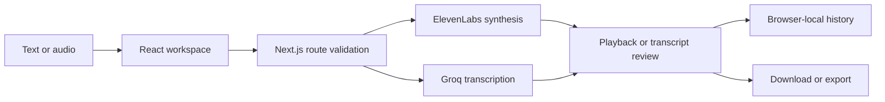

# Architecture and local operation

Sonora has two product flows in one Next.js application. Voice handles text-to-speech; Scribe handles transcription and review. Shared UI state, local history and provider configuration support both flows.

## Component boundaries

- `components/tts`: text input, voice selection, playback and generation results.
- `components/transcribe`: batch input, transcript review and history.
- `components/api-keys`: local key configuration and quota feedback.
- `app/api`: provider-facing route handlers and request validation.
- `lib/server`: provider clients, quota handling, request helpers and runtime defaults.
- `lib/transcripts.ts`: browser-side transcript persistence and export support.
- `scripts/transcribe.py`: a separate CLI helper, not the web application's background worker.

## Credentials and data

Server defaults come only from `ELEVENLABS_API_KEY`, `GROQ_API_KEYS` or `GROQ_API_KEY`. Missing configuration does not activate an embedded fallback. Users may configure their own provider keys through the UI; browser storage is not a shared server vault. Keep browser profiles private.

Text/audio processing uses the selected external provider. History is device-local and can be lost when browser storage is cleared. Export important material separately. Do not submit recordings or text you are not authorized to process.

## Local verification

Run `npm test`, `npm run typecheck` and `npm run build`. The configuration tests verify that no default credential exists without runtime configuration and that placeholders are rejected. They do not make provider calls.

Quota enforcement, provider availability, real audio quality, browsers and concurrent multi-instance behavior require separate validation. The included source is not a guarantee of free provider access or production capacity. Git-driven Vercel deployment is disabled; these commands do not publish the application.
